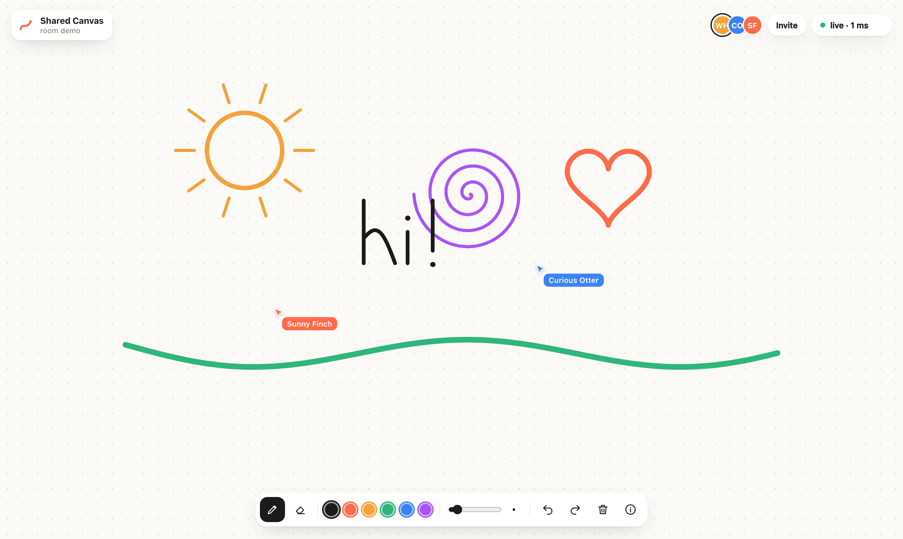
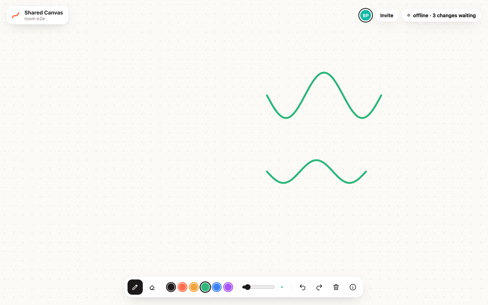
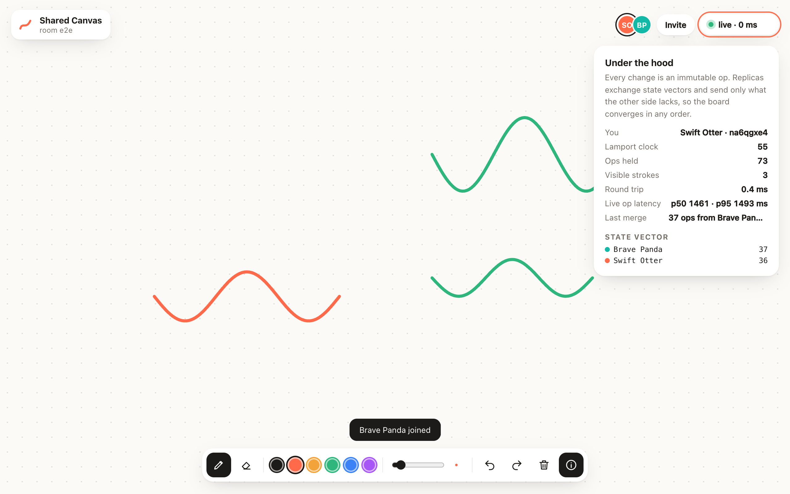

# Shared Canvas

**A local-first multiplayer whiteboard built on a CRDT I wrote from scratch.**
Draw together in real time, keep drawing with no connection, and when everyone comes back online every stroke merges with no conflicts and nothing lost.



```bash
npm install
npm start            # http://localhost:8787  (open it in two tabs, or on your phone)
npm test             # 16 unit + integration tests, including 500 randomised convergence runs
npm run test:e2e     # two real Chrome browsers draw, go offline, diverge, reconnect, converge
npm run bench        # CRDT merge throughput + WebSocket sync latency
```

No framework and no CRDT library: the core is about 200 lines of plain JavaScript that run unchanged in the browser, on the server and in the tests. The only runtime dependency is `ws`.

---

## What it does

- **Real-time drawing.** Strokes stream to everyone as they're drawn, in 40 ms chunks, so you watch other people's lines appear live. You can see their cursors too.
- **Works offline.** Every op is saved to IndexedDB first, so you can close the laptop, keep drawing on a plane, or lose Wi-Fi. The status pill shows how many changes are waiting.
- **Merges without conflicts.** When you reconnect, both sides compare state vectors and send exactly what the other side is missing, nothing more and nothing twice.
- **Undo, redo, eraser, clear, pan and zoom**, plus pinch-zoom and two-finger pan on touch screens.
- **"Under the hood" panel** (press `I`): a live view of the Lamport clock, the state vector, the ops held, the round-trip time and how long each merge took.

| Offline, edits waiting | Back online, merged |
|---|---|
|  |  |

---

## How it works

### 1. Everything is an immutable op

```
stroke  { id, color, width }          start a stroke
points  { id, idx, pts: [[x,y],...] } chunk #idx of that stroke's points
delete  { id }                        remove a stroke
```

Every op is stamped with `(client, seq)`, which makes it unique, and with a **Lamport clock**. A replica is just the set of ops it has seen, and the board is a pure function of that set.

### 2. Why it always converges

Applying an op is idempotent and commutative:

| Rule | Why it matters |
|---|---|
| An op is keyed by `client:seq`, so a duplicate is ignored | Retries and re-syncs are harmless |
| Stroke chunks are keyed by `idx` and drawn in index order | Chunks can arrive in any order; a missing chunk truncates the stroke instead of scrambling it |
| Strokes form a **2P-set**: delete wins, even if the delete arrives before the stroke | Concurrent "Alice extends it, Bob erases it" resolves the same way everywhere |
| Stacking order is the total order `(lamport, client)` | Every screen layers overlapping strokes identically |

So any two replicas that hold the same ops render byte-identical boards, whatever the delivery order, duplication or time offline. The tests check exactly that: **500 randomised sessions**, three replicas each, every op delivered in a different shuffled order with ~30% duplicates, then the board fingerprints are compared.

### 3. Sync is just set reconciliation

```
client → server   hello   { stateVector }        "I have alice:1..40, bob:1..12"
server → client   welcome { stateVector, ops }   everything the client lacks
client → server   ops     { ops }                everything the server lacks
                  ...then live ops in both directions
```

The state vector records the highest **contiguous** seq per client, so a gap (say we have seq 1 and 3 but not 2) automatically gets re-sent. Reconnecting after a day offline uses exactly the same code path as connecting for the first time, which is why there's no fragile outbox or retry queue.

The server is simply one more replica. It stores ops in an append-only JSON-lines log per room and forwards new ones. It never resolves conflicts, because there's nothing to resolve.

```
 Browser A ──┐                         ┌── Browser B
  replica    │   WebSocket (JSON ops)  │    replica
  IndexedDB  ├──────►  server  ◄───────┤    IndexedDB
             │        replica          │
             │     rooms/*.jsonl       │
```

---

## Results

Measured on an Apple M4 laptop with Node 18 (`npm run bench`):

**CRDT** (two people each draw 2,500 strokes offline, 52,500 ops each, then merge)

| | |
|---|---|
| Find what's missing (state-vector diff) | 11.7 ms for 105,000 ops |
| Merge two offline sessions | 39 ms, **≈2.7 million ops/s** |
| Re-deliver everything again | 9.5 ms, 0 ops applied (idempotent) |
| Rebuild and compare 5,000 strokes | 98 ms; both replicas identical |

**Sync latency** (one person drawing at 60 updates/s over real WebSockets, time until every other client has applied each op; localhost, same clock)

| Clients watching | p50 | p95 | p99 |
|---:|---:|---:|---:|
| 2 | 1.1 ms | 1.8 ms | 2.7 ms |
| 20 | 2.4 ms | 3.9 ms | 4.8 ms |
| 50 | 4.5 ms | 6.6 ms | 7.8 ms |

A deliberate burst of 5,000 ops with no pacing sustains **~91,000 op deliveries/s** to 20 clients. Latency in that run is queueing (p50 ≈ 0.7 s), which is the expected trade-off when the pipe is saturated.

These are localhost numbers, so they measure the software, not the network. Over the internet, add your round-trip time.

**Browser end-to-end** (`npm run test:e2e`): two separate Chrome profiles draw. Both go offline, and one erases the other's stroke while the other keeps drawing. Both reconnect and converge to an identical 73-op, 3-stroke board in about 40 ms, and the board survives a page reload.

---

## Design decisions and trade-offs

- **Op-based CRDT over operational transform.** OT needs a central server to transform concurrent edits, while a CRDT lets any replica merge with any other. That's what makes offline-first and peer-to-peer possible later.
- **Hand-written instead of Yjs or Automerge.** A drawing board needs only three op types, and owning the core keeps it small, fast and fully explainable. For rich text I'd reach for Yjs.
- **Delete wins (2P-set).** Simple and predictable. The cost is that a deleted stroke can't be un-deleted, so **redo re-adds a copy under a new id** instead of reviving the old one.
- **Points stream in chunks**, so peers see strokes being drawn live without sending one message per mouse event.
- **Validation at the edge.** Ops are structurally validated before they touch a replica: size limits, finite numbers, bounded ids. A buggy or hostile client can't corrupt anyone's board (this is tested).

### What I'd do next
- **Compaction:** periodically snapshot the board and drop the op history for deleted strokes. Right now the log grows forever.
- **Binary encoding:** delta-encode point coordinates instead of sending JSON, roughly 5–10× smaller.
- **Peer-to-peer over WebRTC**, so the server is optional. The CRDT already supports it.
- **Viewport-aware rendering:** cache tiles and redraw only what changed, instead of redrawing every stroke each frame.

---

## Project layout

```
src/crdt.js          the CRDT: ops, merge, state vectors, materialised board
src/sync-client.js   client half of the sync protocol (browser + Node)
server/server.js     static files + WebSocket relay that is itself a replica
public/              the app: canvas, tools, presence, IndexedDB, inspector
test/                unit, fuzz and integration tests (node --test)
e2e/                 real-browser test with puppeteer-core
bench/               merge throughput and sync latency
scripts/             demo seeding and screenshots
```

MIT licensed. Built by [Arya Sahu](https://github.com/kirbynuggets).
